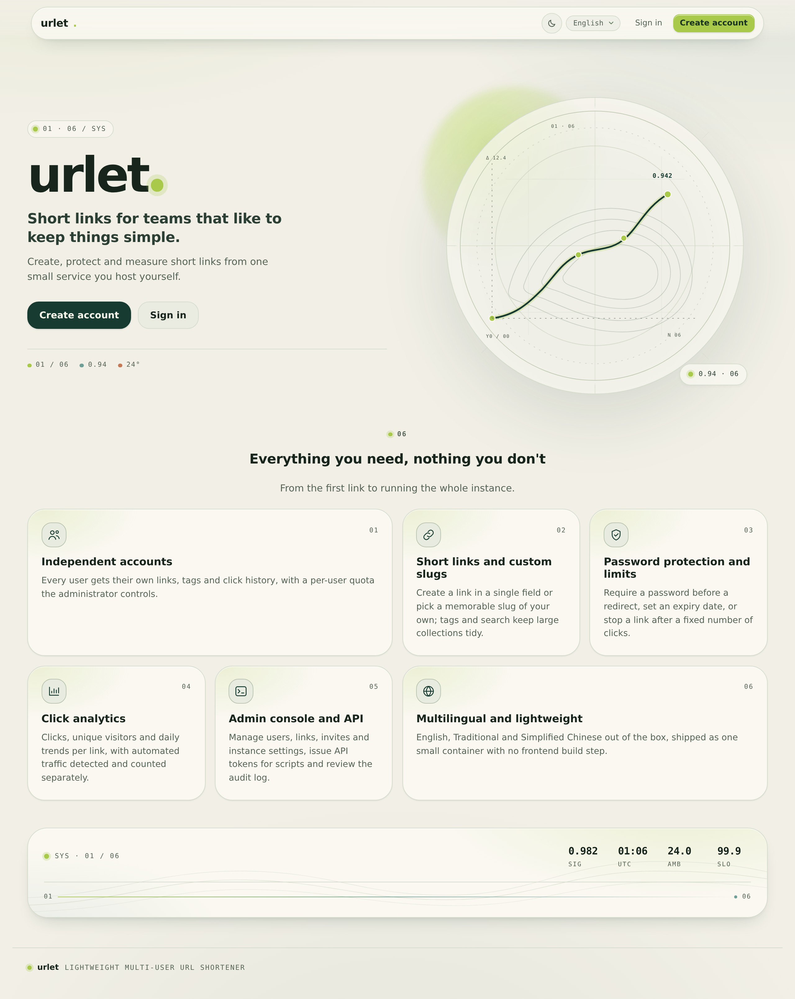
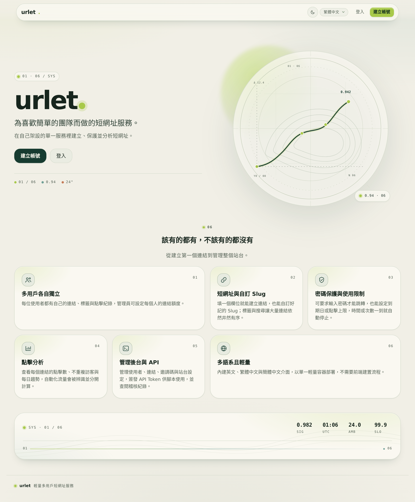
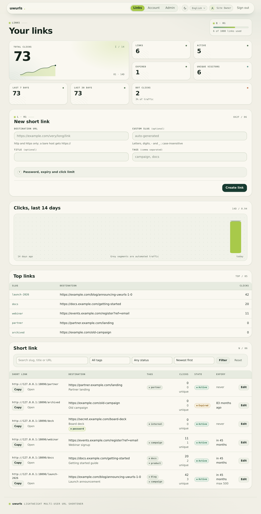
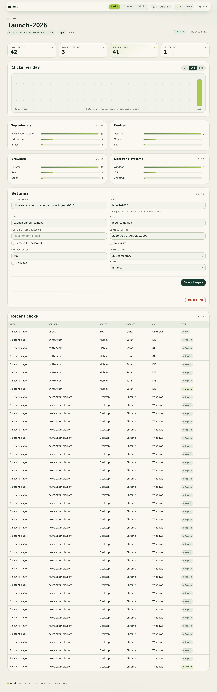
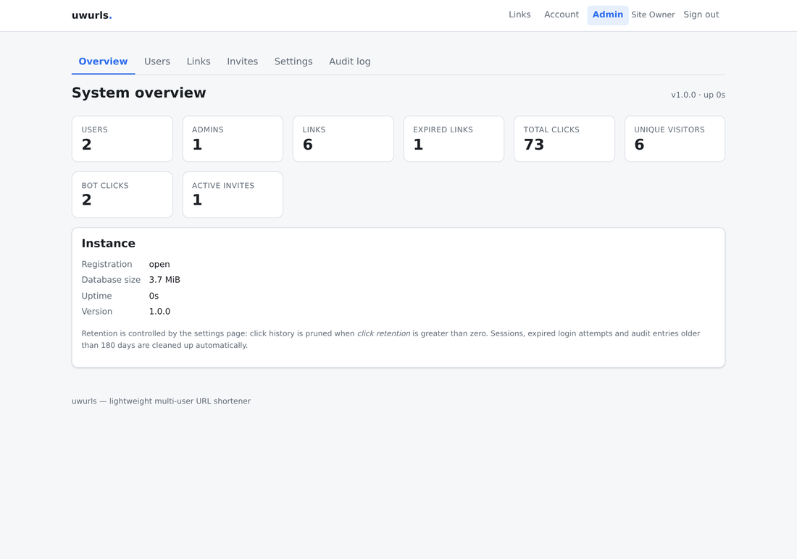
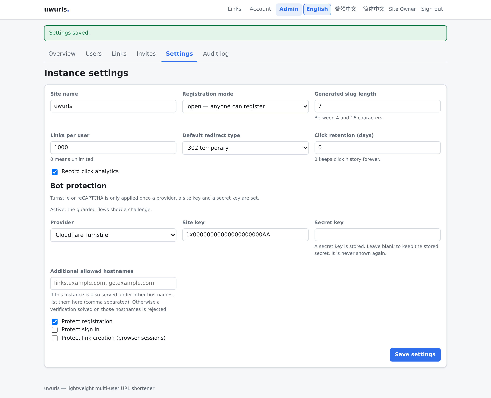
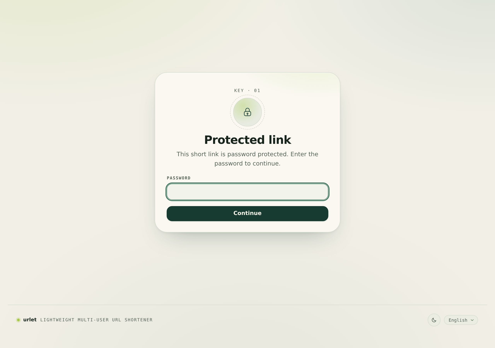
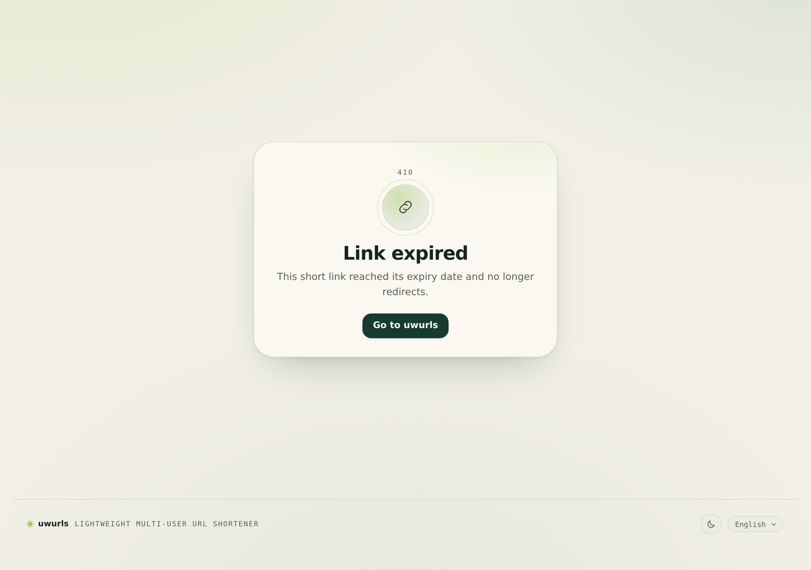
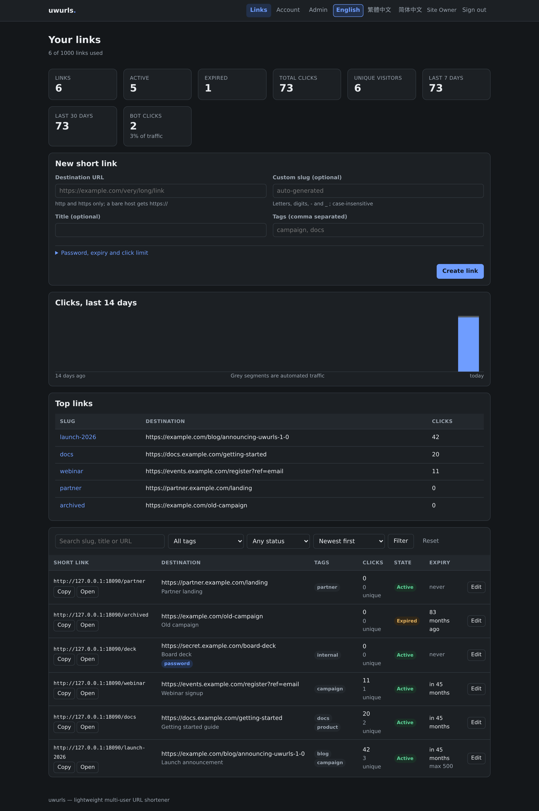

[English](README.md) | **繁體中文**

# urlet

**輕量化、自託管的多用戶短網址系統。** 單一 Rust 二進位檔 + 單一 SQLite 檔案，
一個 `docker compose up -d` 就能上線，不需要外部資料庫、快取服務或前端建置流程。



## 功能

| 功能 | 說明 |
|------|------|
| 👥 多用戶 | 每位使用者獨立管理自己的短網址；跨帳號存取一律 404 |
| 🏠 導覽首頁 | `/` 是介紹與導覽頁，提供登入與註冊入口，不再直接跳轉到登入頁 |
| ⚡ 公開短網址工具 | 導覽首頁可提供免帳號訪客使用的縮網址表單。管理員可決定誰能建立連結（訪客、使用者或僅限管理員）以及表單提供哪些欄位，以設定的防機器人驗證保護，並以每來源位址與全體訪客共用的速率限制把關 |
| 🔗 短網址管理 | 自訂或自動產生 slug、標題、備註、標籤、啟用/停用、軟刪除 |
| 🔒 密碼保護 | 短網址層級密碼（Argon2id），解鎖後以簽章 Cookie 記住 30 分鐘 |
| 🚏 中轉頁 | 可選的中間頁，在前往目標前顯示倒數、自訂標題／說明與目的地主機；支援自動與手動繼續，並可逐連結設定秒數 |
| ⏳ 過期機制 | 絕對到期時間與點擊次數上限，過期回 410 Gone |
| 📊 點擊分析 | 每日趨勢、來源網域、裝置/瀏覽器/作業系統分佈、最近點擊 |
| 🧩 標籤 | 依標籤篩選與分類，附使用次數 |
| 🔑 API Token | `Authorization: Bearer ur_...`，可設到期與撤銷 |
| ✉️ 邀請連結 | 每組邀請碼都有會預填邀請碼的註冊連結；邀請碼會保留供查閱，連結則只在邀請碼可用時提供 |
| 🌐 多網域 | 可在管理後台新增額外網域；各網域有獨立 slug，僅提供轉址 |
| 👥 使用者群組 | 各群組可設定連結、API Token 與邀請碼配額（每日／每週／每月）、功能開關、轉址方式政策（僅直接跳轉／僅中轉頁／由成員選擇）、預設網域與允許網域；成員可在群組允許時自行產生邀請碼 |
| 🎨 佈景主題 | 六個內建設計（Verdant、Aurora、Paper、Signal、Gilded、Swiss）與管理員上傳的 CSS 主題；可決定提供哪些、預設主題，以及誰能切換（僅管理員，或包含未登入訪客的所有人）。上傳內容保存在 `urlet-themes` volume |
| 🛠 管理後台 | 使用者管理、使用者群組、全站短網址、網域、邀請碼、主題、站台設定、稽核日誌 |
| 🌐 多語系介面 | 介面提供 English / 繁體中文 / 简体中文 切換；初次訪問依瀏覽器 `Accept-Language` 自動選擇，無法辨識時預設英文 |
| 🤖 防機器人驗證 | 可透過環境變數或管理後台啟用 Cloudflare Turnstile 或 Google reCAPTCHA v2，套用於註冊、登入與建立短網址表單 |
| 🐳 部署 | 單一容器 + named volumes；GHCR 提供多架構映像；附 Caddy 自動 HTTPS overlay |
| 🪶 輕量 | 二進位檔 5.7 MB（glibc）／5.8 MB（musl）、容器映像 14.8 MB、500 次請求後 RSS 8.7 MB、轉址 P95 低於 1 毫秒（說明見下） |

> 二進位檔與映像的數字已包含內嵌語言目錄，以及選用的防機器人驗證所需的 TLS 相依；轉址延遲
> 為 v1.0 的量測值，預期不變 —— 驗證只在註冊、登入與建立短網址表單執行，轉址路徑完全不受影響。

## 快速開始

### Docker Compose（推薦）

```bash
git clone <this repo> urlet && cd urlet
cp .env.example .env      # 至少設定 URLET_BASE_URL 與管理員帳密
docker compose up -d --build
```

打開 `http://localhost:8080`。導覽首頁提供登入與註冊入口，請用 `.env` 裡的
`URLET_ADMIN_EMAIL` / `URLET_ADMIN_PASSWORD` 登入（伺服器啟動時會自動建立該管理員）。

想讓 Caddy 自動申請 HTTPS 憑證：

```bash
export URLET_DOMAIN=s.example.com
docker compose -f docker-compose.yml -f docker-compose.tls.yml up -d --build
```

> 需要 Docker Compose ≥ 2.24（overlay 使用 `!override` 標籤）。

### 使用預先建置的映像

每次推送 `v*` 標籤都會發布多架構映像（`linux/amd64` 與 `linux/arm64`）到 GitHub Container
Registry，因此不必自己編譯 Rust：

```bash
export URLET_IMAGE=ghcr.io/cxyfer/urlet:latest   # 正式環境請固定版本標籤
docker compose -f docker-compose.yml -f docker-compose.image.yml up -d
```

此 overlay 會移除本機 `build` 設定，改為直接拉取映像。套件可能是私有的，請先執行
`docker login ghcr.io`（需要具備 `read:packages` 的權杖），或在
*Package settings → Change visibility* 將套件設為公開。固定版本與升級方式見
[`docs/zh-TW/DEPLOYMENT.md`](docs/zh-TW/DEPLOYMENT.md#21-使用預先建置的映像)。

### 直接執行二進位檔

```bash
cargo build --release
URLET_BASE_URL=http://localhost:8080 \
URLET_DATA_DIR=./data \
URLET_ADMIN_EMAIL=admin@example.com \
URLET_ADMIN_PASSWORD=change-me-please \
./target/release/urlet serve
```

### 命令列

```
urlet serve                 # 啟動伺服器（預設）
urlet migrate               # 套用資料庫遷移後結束
urlet healthcheck [URL]     # 健康檢查（容器 HEALTHCHECK 使用，無需 curl）
urlet version | help
```

## 首次使用

1. 若設定了 `URLET_ADMIN_EMAIL` / `URLET_ADMIN_PASSWORD`，啟動時會建立管理員。
2. 若資料庫中**沒有任何帳號**，第一位註冊的使用者會自動成為管理員。
3. 之後可在 **Admin → Invites** 產生邀請碼，並在 **Admin → Settings** 把註冊模式改為
   `invite`（僅邀請碼）或 `closed`（關閉註冊）。每組邀請碼都會附一組註冊連結，可直接
   傳送連結，開啟後會自動預填邀請碼。

## 畫面

導覽首頁，以及同一頁在訪客瀏覽器語言被辨識後自動切換的結果：

| 導覽首頁 | 繁體中文（自動辨識） |
|---|---|
|  |  |

登入後：

| 儀表板 | 短網址詳情與統計 |
|---|---|
|  |  |

| 管理後台 | 防機器人驗證設定 |
|---|---|
|  |  |

| 密碼保護頁 | 已過期連結（可一鍵延長） |
|---|---|
|  |  |

深色模式：

重新產生截圖：`SHOTS=docs/screenshots ./scripts/demo.sh`（需要 Playwright 與 Chromium）。

## 技術選擇

| 層級 | 選擇 | 為什麼 |
|------|------|--------|
| HTTP | Axum 0.8 + Tokio | 型別安全、生態成熟、單一二進位 |
| 資料庫 | SQLite（sqlx，WAL） | 免外部服務、單檔備份，自託管規模足夠 |
| 遷移 | 內嵌 SQL + checksum 驗證 | 啟動自動遷移，二進位檔自帶 schema |
| 介面 | Askama SSR + 手寫 CSS/JS | 沒有 Node/Vite 建置步驟，映像檔極小 |
| 認證 | 伺服器端 Session + API Token | 可即時撤銷，不必引入 JWT 相依 |
| 密碼 | Argon2id（19 MiB, t=2, p=1） | OWASP 建議參數 |

**刻意不做**：OAuth、細緻權限矩陣、GeoIP、關鍵字黑名單、Webhook、郵件寄送。
資料表與架構已為這些功能預留空間（見 `docs/SPEC.md` §12）。

## 專案結構

```
urlet/
├── .github/workflows/release-image.yml  # 標籤觸發的多架構映像發布
├── Cargo.toml
├── Dockerfile                  # 多階段建置（rust:alpine → alpine）
├── docker-compose.yml          # 單一容器 + named volume
├── docker-compose.image.yml    # 使用已發布映像，不在本機建置
├── docker-compose.tls.yml      # 可選：Caddy 自動 HTTPS
├── deploy/Caddyfile
├── migrations/                 # 內嵌 SQL 遷移
├── templates/                  # Askama 模板（編譯期檢查）
├── scripts/
│   ├── smoke.sh                # 端對端驗收測試（curl）
│   ├── demo.sh                 # 產生示範資料並截圖
│   └── screenshot.py           # Playwright 截圖腳本
├── src/
│   ├── assets/                 # 內嵌 CSS/JS/favicon
│   ├── db/                     # 所有 SQL（每張表一個模組）
│   ├── middleware/             # 認證、CSRF、安全標頭、request id
│   ├── routes/                 # HTTP：api_*、pages/*、redirect、health
│   ├── services/               # 業務邏輯：auth、urls、slug、click、admin...
│   ├── config.rs  error.rs  state.rs  server.rs
│   └── main.rs                 # CLI 入口
└── docs/{SPEC.md,PLAN.md,API.md,DEPLOYMENT.md,THEMES.md}
```

## 開發

```bash
cargo test                 # 單元 + 整合測試（518 個）
cargo clippy --all-targets -- -D warnings
cargo fmt --check
bash scripts/smoke.sh      # 對真實二進位檔跑端對端驗收（172 項）
bash scripts/demo.sh       # 產生示範站並輸出截圖到 .tmp/demo/shots
```

需要 Rust 1.80 以上。整合測試使用獨立的臨時 SQLite，不會碰到你的開發資料。

## 發布新版本

發布採標籤驅動，完整規則見 [`RELEASING.md`](RELEASING.md)（[中文版](docs/zh-TW/RELEASING.md)），
建立標籤前請先閱讀。簡要流程：更新 [`Cargo.toml`](Cargo.toml) 的 `version`、同步
`Cargo.lock`、提交，然後推送 annotated 的 `vX.Y.Z` 標籤。workflow 會驗證標籤、建置
`linux/amd64` 與 `linux/arm64`，並以 semver 標籤發布 `ghcr.io/cxyfer/urlet`。只有最新正式版會
移動 `X`、`X.Y` 與 `latest`；預發布版不會。GitHub Release 之後由人工撰寫。

若只想重建既有標籤，請從 *Actions → Release container image → Run workflow* 手動執行
（除非是最新正式版本，否則不要開啟浮動標籤）。

## 文件

- [`docs/SPEC.md`](docs/SPEC.md) — 規格書：需求、資料模型、API、非功能需求
- [`docs/PLAN.md`](docs/PLAN.md) — 分階段實作計畫與驗收標準
- [`docs/API.md`](docs/API.md) — JSON API 參考
- [`docs/DEPLOYMENT.md`](docs/DEPLOYMENT.md) — 部署、設定、備份、升級、疑難排解
- [`docs/zh-TW/THEMES.md`](docs/zh-TW/THEMES.md) — 主題目錄、管理操作與新增主題的方式
- [`RELEASING.md`](RELEASING.md) — 發布規則：版本、標籤與映像規則、檢查清單、回滾（[中文版](docs/zh-TW/RELEASING.md)）

這些文件的中文版放在 `docs/zh-TW/`。

## 安全性

- Argon2id 密碼雜湊；Session 與 API Token 只存雜湊值。邀請碼保留 SHA-256 雜湊供查詢，
  另存以 `URLET_SECRET` 衍生金鑰進行 ChaCha20-Poly1305 加密封存的副本；這能避免資料庫直接
  出現明文，但雜湊與四字元前綴仍可離線猜測，且自動產生的 `secret.key` 就在資料庫旁，
  因此資料庫與資料目錄備份仍應視為敏感資料。更換密鑰會讓既有封存無法顯示（邀請碼本身仍可兌換）
- Cookie：`HttpOnly`、`SameSite=Lax`、可強制 `Secure`
- CSRF：Cookie 認證的狀態變更請求檢查同源；表單類請求一律檢查
- 安全標頭：CSP（`default-src 'self'`）、`X-Content-Type-Options`、
  `X-Frame-Options`、`Referrer-Policy`、HTTPS 時加 HSTS
- 開放轉址防護：目標僅允許 `http`/`https`，`javascript:`/`data:`/`file:` 一律拒絕
- 隱私：不存原始 IP，只存 HMAC 後的 `ip_hash` 與每日輪替的 `visitor_hash`
- 速率限制：登入（每 IP 與每帳號兩層）、註冊、解鎖、建立短網址、改密碼
- 防機器人驗證：可選 Turnstile 或 reCAPTCHA v2，套用於註冊、登入與建立短網址，
  並以 `URLET_CAPTCHA_ON_REGISTER`、`URLET_CAPTCHA_ON_LOGIN`、
  `URLET_CAPTCHA_ON_CREATE` 逐表單開關
- 帳號鎖定：同一帳號 15 分鐘內 30 次失敗即暫時拒絕登入（持久化，重啟不重置）
- 反向代理：優先信任代理設定的 `X-Real-IP`，其次取 `X-Forwarded-For` 最右側
- 密碼雜湊在阻塞執行緒池中進行，並限制同時最多 4 個 Argon2 計算
- 稽核日誌：登入、註冊、短網址異動、Token、管理操作、設定變更

## 授權

MIT，見 [`LICENSE`](LICENSE)。
